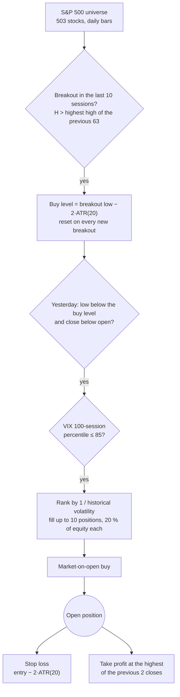
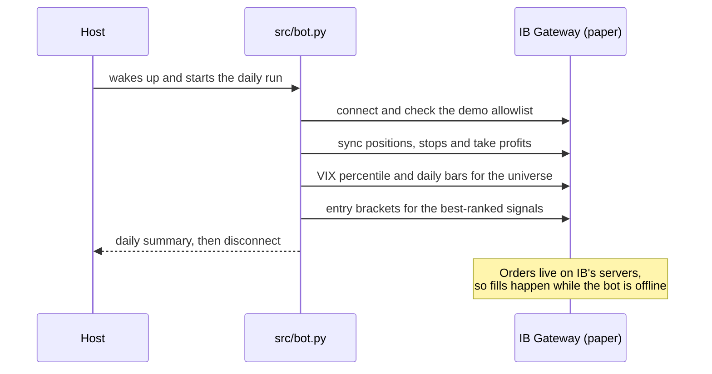

# Systematic Market Structure Trading Bot

A **long-only swing trading bot for S&P 500 stocks**, built on [`ib_async`](https://github.com/ib-api-reloaded/ib_async) and Interactive Brokers.
It implements Critical Trading's *Systematic market structure trading strategy*, originally written in AmiBroker AFL, and runs once a day against IB Gateway in **paper trading**.

> [!IMPORTANT]
> Demo account only. `src/demo_guard.py` refuses to start against any host, port or account outside its allowlist, and it cannot be disabled.
> This project is for study purposes and is not investment advice.

## Strategy

Every trading day, before the US open, the bot evaluates the AFL rules on the daily bars of each S&P 500 constituent, using only completed sessions.



| Rule | AFL | Implementation |
| --- | --- | --- |
| Breakout | `H > Ref(HHV(H, 63), -1)` | 63-session highest high, excluding the current bar |
| Entry window | `BarsSince(H_breakout) < 10` | 10 sessions from the latest breakout |
| Buy level | `Low − 2 × ATR(20)` on the breakout bar, cancelled once touched | Same loop, recomputed on every breakout |
| Buy | `L < Ref(Limit_buy, -1) && C < O && VIX filter` | Market-on-open order the next morning |
| Stop | `Ref(ATRvar, -1)` points below entry | Good-till-cancelled stop, child of the entry order |
| Exit | `C > Ref(HHV(C, 2), -1)`, sold at the close | Good-till-cancelled limit sell at that level, repriced every morning: it fills as soon as the price touches it (see below) |
| Ranking | `PositionScore = 1 / HV(252)` | Lowest annualised volatility first |

### Exit: take profit instead of the close

The AFL sells at the close when the close beats the highest of the two previous closes. On IB, a limit-on-close order cannot share a one-cancels-all group with the stop, so the bot uses a classic bracket: entry, stop and take profit, where filling one exit cancels the other. The take profit sells as soon as the price touches the level during the session, at that level, rather than waiting for the close. On six years of real data for 80 S&P 500 stocks both exits produced a similar number of trades and results, with the take profit holding positions for less time.

## How it runs



| Module | Role |
| --- | --- |
| `src/bot.py` | Entry point: connects, applies the demo guard, runs the strategy and writes the daily summary |
| `src/strategy.py` | Signals, ranking, orders and the SQLite state of open positions |
| `src/sp500.txt` | The trading universe, in IB symbol format |
| `src/demo_guard.py` | Fail-closed allowlist of hosts, ports and paper accounts |
| `src/ib_observer.py` | Wraps the IB client to log orders, fills, errors and latencies |
| `src/events.py` | Structured JSON-lines logging with secret redaction and a daily summary |
| `src/backtest.py` | Runs the real `run_once` day by day against a simulated broker |

## Backtest

The backtester does not reimplement the strategy: it drives the same `strategy.run_once` against a simulated broker that fills market-on-open, stop and take profit orders, with no look-ahead.

```bash
venv/bin/python src/backtest.py --synthetic --seed 42             # reproducible synthetic market
venv/bin/python src/backtest.py --csv-dir data/ --out run.json     # one SYMBOL.csv per stock plus VIX.csv
```

CSV files need the columns `date,open,high,low,close,volume` with ISO dates. Synthetic data validates the mechanics, not returns.

## Development

Requires Python 3.13.

```bash
python3 -m venv venv
venv/bin/pip install -r requirements.txt -r requirements-dev.txt

venv/bin/ruff check .     # lint
venv/bin/mypy             # types
venv/bin/pytest           # tests, including a golden backtest fingerprint
```

`tests/test_strategy_characterization.py` pins the strategy's behaviour, so any change to its rules shows up as a failing test.

> [!WARNING]
> Do not run `src/bot.py` to try things out: it sends real orders to the paper account and changes the bot's state.

## Credits

Strategy by [Critical Trading](https://www.critical-trading.com), presented in [part 1](https://youtu.be/QKCDt2QnmeM) and [part 2](https://youtu.be/rKGXIopVeQ0).
